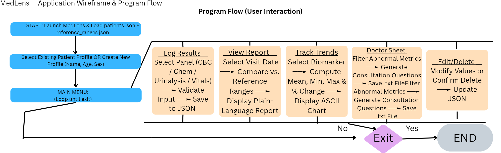
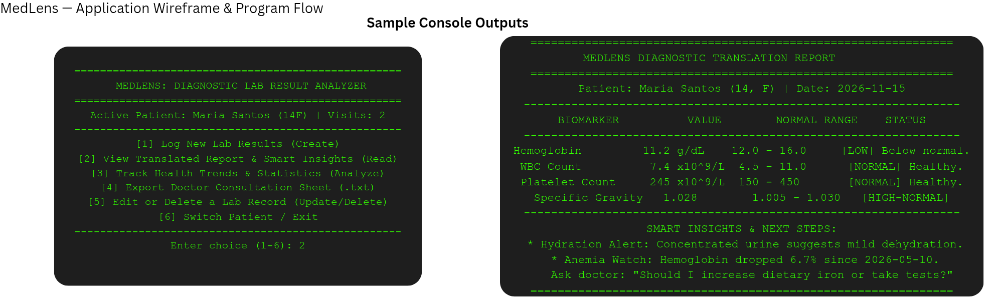

**Project Milestone 1: Develop the First Draft of the Project Proposal**

## **1\. Project Title**

**Project Name:** MedLens — Comprehensive Lab Result & Health Trend Analyzer

---

## **2\. Brief Description** 

**Description:**

MedLens is a Python-based diagnostic translation and health-tracking application that converts complex hospital laboratory results (CBC, Urinalysis, Blood Chemistry, and Vital Signs) into clear, everyday language. Using persistent JSON storage, the program stores a user's multi-visit medical history, flags abnormal values using age- and sex-specific clinical ranges, detects cross-metric health patterns, and generates a printable doctor-visit checklist and longitudinal trend graphs.

## **3\. Problem Statement:**

**Problem Identified:**

When patients receive routine laboratory results—such as a Complete Blood Count (CBC), urinalysis, or blood chemistry panel—the printouts are filled with medical abbreviations (e.g., WBC, Hgb, RBC, SGPT, LDL) and raw numerical values without context. Patients often feel anxious or confused because they do not know which numbers are urgent, which are harmless fluctuations, or how their current results compare to past checkups. MedLens solves this problem by acting as a personal medical translator: it organizes lab data across multiple hospital visits, explains each biomarker in plain English, highlights potential health patterns, and prepares structured summaries for follow-up consultations.

**Target Users / Beneficiaries:**

1. *Patients and Individuals*: People who undergo routine laboratory tests and want to understand their results through simplified explanations and organized health records.  
2. *Families and Caregivers*: Individuals responsible for monitoring the health records of family members, particularly children, older adults, and dependents who require regular medical checkups.  
3. *Individuals with Chronic Health Conditions*: Patients who undergo frequent laboratory examinations and need to monitor changes in health indicators, such as blood glucose, cholesterol, and kidney function, over time.  
4. *Healthcare Professionals*: Doctors and other healthcare providers who may use organized historical records and generated summaries as supplementary references during patient consultations.  
5. *Health-Conscious Individuals*: People who regularly undergo preventive checkups and want to keep track of their laboratory results from different medical visits.

Primary Beneficiaries: Patients and their families, as MedLens aims to make laboratory results easier to understand, organize, and monitor over time.

## **4\. Outline of Features**

The following table presents the proposed features of MedLens, their respective functions, and the persistent data utilized to support continuous laboratory record management, analysis, and health monitoring.

|  |  |  |
| ----- | ----- | ----- |
| **Feature** | **Description** | **Persistent Data Used** |
| **Feature 1: Multi-Panel Lab Record Management (Full CRUD)** | Allows users to Create, Read, Update, and Delete patient profiles and laboratory records. Users can log new laboratory visits categorized into CBC, Blood Chemistry, Urinalysis, and Vital Signs without being required to enter every test included in their hospital results. They can view individual laboratory reports with plain-language translations or browse a patient's complete chronological medical timeline. Users can also correct incorrect entries, update patient information such as age and weight, add late-arriving test results to existing visits, and delete duplicate records or obsolete patient profiles through confirmation prompts. | patients.json stores unique patient IDs, patient profiles, visit IDs, visit dates, clinic notes, and laboratory results organized by test panel. |
| **Feature 2: Age- and Sex-Adjusted Plain-Language Translator** | Uses modular Python functions to evaluate individual biomarkers against age- and sex-specific clinical reference ranges. It translates medical abbreviations and numerical values into understandable explanations, describing what each biomarker measures, what elevated or decreased results may indicate, and common non-alarming factors that may influence the results, such as dehydration. Values outside the applicable reference ranges are flagged for further attention. | reference\_ranges.json stores biomarker definitions, measurement units, clinical reference ranges, and age- and sex-specific thresholds. Patient age and sex are retrieved from patients.json to determine the appropriate reference ranges. |
| **Feature 3: Cross-Metric Pattern Detector (Smart Insights)** | Uses conditional logic and arrays to analyze combinations of laboratory results and identify potential health patterns rather than evaluating each biomarker independently. Examples include a Possible Dehydration indicator when elevated urine specific gravity occurs alongside slightly elevated hemoglobin, and an Infection/Inflammation Indicator when the White Blood Cell (WBC) count is elevated. These indicators provide educational insights and are not intended to establish medical diagnoses. | patients.json stores laboratory measurements and a flagged\_insights array containing generated plain-language summaries and potential cross-metric patterns. |
| **Feature 4: Longitudinal Trend Analysis and Descriptive Statistics** | Uses iterative loops to analyze a patient's historical laboratory records and calculate minimum, maximum, mean (average), standard deviation, range, and percentage change from the previous visit. It also generates ASCII trend charts to visually represent changes in laboratory values across multiple checkups, allowing users to monitor health indicators over time, such as blood glucose and cholesterol levels. | patients.json stores historical laboratory measurements and their corresponding visit dates, which are retrieved and compared to calculate descriptive statistics and generate chronological trend charts. |
| **Feature 5: Doctor Consultation Preparation and Exportable Summary** | Automatically compiles flagged and abnormal laboratory results, observed trends, and relevant patient information into a clean, structured, and printable .txt summary report. The report is saved in the /outputs directory and includes suggested questions that patients can ask their physicians during follow-up consultations. | patients.json provides patient profiles, laboratory records, and flagged insights used to generate consultation summaries. Generated reports are saved as .txt files in the /outputs directory. |
| **Feature 6: Strict Input Validation and Medical Disclaimer** | Implements strict input validation to prevent incorrect entries, invalid data types, and unrealistic physiological values, such as accidentally entering 140 instead of 14.0 for hemoglobin. The application also displays an educational medical disclaimer explaining that MedLens supports the understanding and monitoring of laboratory results but does not replace professional medical diagnosis or consultation. | reference\_ranges.json provides applicable clinical reference information for range validation, while patients.json stores validated patient information and laboratory entries. The medical disclaimer is displayed within the application. |

## **5\. Description of Data to be Collected and Stored as Persistent Data (Optional)**

*MedLens will collect, store, and retrieve patient information, laboratory test results, clinical reference ranges, and generated health insights using structured JSON files. The primary persistent data will be stored in data/patients.json and data/reference\_ranges.json. These records will allow the application to maintain a patient's medical history across multiple visits, evaluate laboratory results, identify potential patterns, and generate consultation summaries. The data fields may be revised and finalized during the Third Quarter as database design and data management concepts are further discussed.*

| Data Field | Description | Purpose/Use |
| ----- | ----- | ----- |
| Patient ID | Unique identifier assigned to each patient or family member. | Used to identify individual patients and organize their medical records |
| Patient Name | Full name of the patient. | Used to identify and display the patient's profile and laboratory history. |
| Age | Patient's age in years. | Used to determine the appropriate age-specific clinical reference ranges. |
| Sex | Biological sex of the patient (M/F). | Used to apply sex-specific clinical reference ranges when applicable. |
| Patient Weight | Patient's recorded weight, measured in kilograms (kg). | Used to maintain updated patient profile information and provide additional context for health monitoring.  |
| Visit ID | Unique identifier assigned to each hospital or clinic visit. | Used to distinguish individual laboratory visits and organize multiple records under one patient.  |
| Date Tested | Date of the laboratory examination in YYYY-MM-DD format. | Used to arrange medical records chronologically and compare results across multiple visits. |
| Clinic Notes | Optional notes related to the patient's laboratory visit, such as fasting duration or the purpose of a follow-up examination. | Provides additional context when reviewing and interpreting laboratory results. |
| Hemoglobin | Measured hemoglobin concentration in grams per deciliter (g/dL). | Used to evaluate oxygen-carrying capacity and monitor changes in hemoglobin levels. |
| WBC Count | White blood cell count, measured in (10^9/L). | Used to evaluate white blood cell levels and identify values that may be associated with infection or inflammation.  |
| Platelet Count | Platelet count, measured in (10^9/L). | Used to monitor platelet levels, particularly during follow-up examinations for conditions such as dengue. |
| Fasting Glucose | Blood glucose concentration measured in milligrams per deciliter (mg/dL). | Used to monitor blood sugar levels and compare results across multiple visits. |
| Total Cholesterol | Total blood cholesterol concentration measured in mg/dL. | Used to monitor cholesterol levels and identify changes over time.  |
| Creatinine | Blood creatinine concentration measured in mg/dL. | Used as a laboratory indicator for monitoring kidney function. |
| Urine pH | Measurement of urine acidity or alkalinity. | Used to evaluate urine pH and identify values outside the applicable reference range.  |
| Specific Gravity | Measurement of urine concentration.Measurement of urine concentration. | Used to assess urine concentration and identify possible hydration-related patterns. |
| Systolic Blood Pressure | Upper blood pressure measurement, recorded in millimeters of mercury (mmHg).Upper blood pressure measurement, recorded in millimeters of mercury (mmHg). | Used to monitor changes in systolic blood pressure across multiple visits. |
| Diastolic Blood Pressure | Lower blood pressure measurement, recorded in mmHg. | Used to monitor changes in diastolic blood pressure across multiple visits. |
| Reference Ranges | Stored clinical reference limits for individual biomarkers, including applicable age- and sex-specific ranges. | Used to evaluate laboratory results and determine whether values fall below, within, or above the applicable reference ranges. |
| Flagged Insights | List of generated plain-language summaries, abnormal result indicators, and potential cross-metric patterns. | Used to display identified patterns, retrieve previously generated insights, and compile relevant information for consultation reports. |
| Generated Report | Exported text file containing patient information, flagged laboratory results, observed trends, and suggested questions for a physician. | Used to provide patients with an organized summary of their laboratory history for medical consultations.  |

## **6\. Sample Wireframe of the Application** 

**Wireframe / Flowchart Area:**

**Screen Description:**

* Screen 1 (Program Flow — User Interaction):

  Shows how the user starts MedLens, loads patients.json and reference\_ranges.json, selects or creates a patient profile, loops through the main menu options (Log Results, View Report, Track Trends, Doctor Sheet, and Edit/Delete), and either exits or ends the program.

* Screen 2 (Sample Console Outputs):

  Displays two dark-mode terminal views—the first shows the active patient header (Maria Santos (14F) \| Visits: 2\) and the numbered main menu (\[1\]–\[6\]) with the Enter choice (1–6): 2 prompt, while the second shows the generated diagnostic translation report table (biomarkers, values, normal ranges, status flags) along with smart insights and suggested doctor questions.

---

## **7\. Task Schedule and Assigned Team Members**

| Task/Activity | Assigned Member(s) | Target Date | Status |
| ----- | ----- | ----- | ----- |
| Project Planning and Repository Setup | Sosobrado | Q2 – Phase 1 | In Progress |
| Project Proposal Development | Sosobrado & Dagani | Q2 – Phase 2 | In Progress |
| Wireframe Creation | Dagani & Ballesteros | Q2 – Phase 2 | In Progress |
| JSON Data Design and File Handling | Sosobrado | Q2 – Phase 3 | Planned |
| CRUD Operations and Menu Development | Sosobrado | Q3 – Phase 4 | Planned |
| Clinical Reference Data and Translation | Dagani & Ballesteros | Q3 – Phase 5 | Planned |
| Smart Insights and Trend Analysis Development | Sosobrado | Q3 – Phase 6 | Planned |
| Consultation Report Generation | Dagani & Ballesteros | Q3 – Phase 6 | Planned |
| Quality Assurance and Testing | All Members | Q4 – Phase 7 | Planned |
| Final Documentation and Project Completion | All Members | Q4 – Phase 7 | Planned |

## 

## 

## 

## 

## **8\. Additional Notes / Considerations**

1. Medical Disclaimer and Limitations: MedLens is designed as an educational and health-monitoring tool, not a medical diagnostic system. Its interpretations and generated insights are intended to help users understand their laboratory results and should not replace professional medical advice, diagnosis, or treatment.

2. Accuracy and Reliability of Reference Ranges: All clinical reference ranges and biomarker explanations must be obtained from reliable medical sources. Reference values may vary depending on the laboratory, testing method, age, sex, and other relevant factors. The application must account for these differences whenever applicable.

3. Data Privacy and Security: Since the application handles sensitive personal and medical information, patient records must be stored securely and accessed only by authorized users. Personal information should not be unnecessarily shared, and sample or anonymized data should be used during development and testing.

4. Data Integrity and Input Validation: The application must validate user inputs to prevent incorrect data types, missing required information, duplicate records, and unrealistic laboratory values. Users should also receive appropriate confirmation prompts before deleting patient profiles or medical records.

5. Persistent Data Management: JSON files will serve as the application's primary storage system. The program must properly handle reading, writing, updating, and retrieving records to ensure that patient information remains available between application sessions. Clinical reference ranges should be maintained separately from patient records to allow future updates without modifying the core program logic.

6. Project Scope and Future Improvements: The initial version of MedLens will focus on a Python-based command-line interface with JSON file storage, laboratory result interpretation, health trend analysis, and consultation report generation. Additional features, such as a graphical user interface, automated laboratory report scanning, and expanded laboratory panels, may be considered for future development depending on the project's time and technical requirements.

7. Development and Testing Considerations: The application will initially be tested using sample or anonymized laboratory records to evaluate its functionality, data accuracy, input validation, and report generation before being used with actual patient information.  
